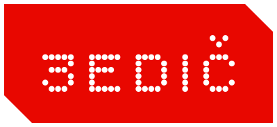

<p align="center"></p>

# 3EDIČ

Sort event photos by competitor number, face and shooting order — on your own computer.

You point 3EDIČ at a folder of photos from a competition (or a conference). It finds every person, reads the number pinned to their shorts where it can, recognises faces, uses the order the photos were shot in, and sorts the photos into one folder per competitor. What it is unsure about goes to a quick review screen. Nothing is uploaded anywhere.

**Status: working prototype.** The engine, API and UI are built and tested on one real event (969 photos, 58 competitors). See [What is not tested yet](#what-is-not-tested-yet) before you rely on it.

## How it decides

1. **People and hips** — YOLOv8-pose finds people and their hip keypoints.
2. **Number** — OCR on the hip area. You can show the app, on two or three photos, where the number sits on your event; it then looks only there.
3. **Face** — YuNet finds the face in the head region, SFace (or optionally ArcFace) turns it into an embedding.
4. **Anchors and galleries** — persons whose number was read (or that you confirmed) become anchors. Their faces and trunks colours form a gallery per competitor, cleaned by consensus so a misread number does not poison it.
5. **Combine** — a small logistic regression turns number evidence, best face match and trunks colour into a probability per (photo, competitor). Default weights ship with the app.
6. **Order** — neighbouring photos (by EXIF time) vote: if the competitor was in the photo a second ago, they probably are in this one.
7. **Review** — confident pairs are assigned automatically; the rest appear in the review screens (grid, cards, group tagging, unknown, album). Every decision becomes a new anchor, so the next rescore gets better.

Optional: send small crops of the hip area (never faces, never whole photos) to a vision LLM (Claude, ChatGPT or Gemini, with your own API key) to read numbers the local OCR could not.

## Measured on the NPC 365 · 3.5. event

969 photos, 58 competitors, 1,430 correct (photo, competitor) pairs from a manual sort. Group shots belong to several competitors; 25 % of photos are in more than one folder.

| Setup | Precision | Recall | Notes |
|---|---|---|---|
| Number only | 88 % | 38 % | OCR reads the number on 45 % of photos |
| + face, trunks, shooting order (Apache-licensed models) | 91 % | 52 % | threshold 0.7, 2-fold cross-fitted |
| + ArcFace | 89 % | 58 % | optional model, non-commercial licence |
| + simulated review: grid, clicking only wrong thumbnails | 95 % | 68 % | 131 clicks for 411 uncertain pairs |
| + AI reads 40 % of the numbers OCR missed (simulation) | 88 % | 64 % | on photos the AI did not touch |

Reading these honestly: roughly half of the correct assignments happen with no human, about 90 % of them right; the rest go to review. In most photos taken from behind or from the side the number is simply not visible, so no local model can read it. The combiner weights were fitted on this same event (cross-fitted numbers are shown; in-sample is within 1 point). A different event may behave differently.

## Install

**Windows and macOS: use the installers** from the [Releases](../../releases) page: `3EDIC-Setup-x.y.z.exe` (Windows 10/11, per-user, no administrator rights) or the `.dmg` for your Mac (`arm64` for Apple silicon, `x86_64` for Intel). The installers are not code-signed yet, so Windows SmartScreen and macOS Gatekeeper will ask you to confirm once (see the release notes). The Windows build uses DirectML, so NVIDIA, AMD and Intel graphics cards are used automatically.

### From source

Requires Python 3.10+.

```bash
pip install .                    # from a checkout
edic                             # opens http://127.0.0.1:8737
```

On Windows with an NVIDIA, AMD or Intel GPU, install the DirectML build of ONNX Runtime instead of the CPU one for a large speed-up, without installing CUDA:

```bash
pip uninstall onnxruntime && pip install onnxruntime-directml
```

The first start shows a setup screen that downloads the models (about 145 MB, resumable, checksum-verified). Project data and models live in the user data directory (`~/.local/share/3edic`, `~/Library/Application Support/3EDIC`, `%APPDATA%\3EDIC`); override with `edic --data-dir PATH`.

## Releasing a new version

Releases are built and published by GitHub Actions; nobody builds or uploads an installer by hand. The result appears on the repository's **Releases** page (`github.com/<owner>/3EDIC/releases`), and that is where users and the in-app updater get it.

**Without a terminal:** GitHub → *Actions* → *Release* → *Run workflow* → type the version (`0.2.0`), tick **Publish a GitHub release**, run. **With a terminal:** `git tag v0.2.0 && git push origin v0.2.0`. Either way the workflow runs the tests, builds the app with PyInstaller on Windows, macOS (Apple silicon) and macOS (Intel), starts each built app headlessly and runs it through the whole vision pipeline (`--smoke --with-models`), builds the Windows installer (Inno Setup) and the `.dmg` files, installs and uninstalls the Windows installer silently as a final check, then creates the release with the files and `SHA256SUMS.txt`. Takes about 20 minutes. A version with a dash (`0.2.0-beta1`) is published as a pre-release. Running the workflow without ticking *Publish* (or with the default `0.0.0.dev0`) does a full test build and publishes nothing.

`.github/workflows/ci.yml` runs the tests on Linux, Windows and macOS for every push and pull request.

### How installed apps get the update

You do nothing beyond pushing the tag. Every installed app asks GitHub for the latest release when it starts and every six hours, and shows a banner ("Update 0.2.0 is ready": release notes, **Update now**, **Later**). *Update now* downloads the installer for that computer, checks its SHA-256 against the release's `SHA256SUMS.txt`, then closes the app, installs and reopens it: on Windows the installer runs silently, on macOS a small script swaps the app in place (if the app sits somewhere it cannot change, it opens the disk image instead). Pre-releases (`v0.2.0-beta1`) are never offered. Users can switch the automatic check off in Settings; a check sends nothing but the request itself to GitHub.

Updates only ever come from this project's GitHub releases, over HTTPS, and are checked against the checksum file the same release publishes, so the update path is only as safe as the GitHub account: keep two-factor authentication on. Code signing (Windows certificate, Apple notarization) is the next layer, see `TODO.md`. The release notes are the GitHub release text, so write them for users.

To change the app icon, replace `packaging/icon-1024.png`; everything else is generated. Code signing is optional and switches on by itself when these repository secrets exist: `WINDOWS_CERT_BASE64` + `WINDOWS_CERT_PASSWORD` (a code-signing certificate as .pfx), and `APPLE_CERT_BASE64`, `APPLE_CERT_PASSWORD`, `APPLE_SIGN_IDENTITY`, `APPLE_ID`, `APPLE_TEAM_ID`, `APPLE_APP_PASSWORD` (Developer ID certificate and notarization). Those steps have not been run yet.

## Group photos

A photo with several competitors is written into the folder of **every** competitor it is assigned to (copy, hard link or shortcut). Which competitors count is the *Which photos go in* setting on the Export tab: **Smart** (confirmed plus very likely), **Readable numbers** (only where a number was read on that photo), **Everyone plausible**, or **Only my decisions**. In *Review → Groups* you click each person on the photo and say who they are, which is the most exact way.

## Models

| Model | Size | Licence | Needed |
|---|---|---|---|
| YOLOv8m-pose (ONNX, [Xenova/yolov8m-pose](https://huggingface.co/Xenova/yolov8m-pose)) | 106 MB | AGPL-3.0 | yes |
| YuNet face detector | 0.2 MB | MIT | yes |
| SFace face embeddings | 39 MB | Apache-2.0 | yes |
| ArcFace w600k_r50 (via [immich-app/buffalo_l](https://huggingface.co/immich-app/buffalo_l)) | 174 MB | InsightFace non-commercial research | no |

3EDIČ is licensed AGPL-3.0, which is compatible with the YOLOv8 licence. **The ArcFace weights are for non-commercial research only.** The app shows this and asks for a tick before downloading them. If you sort photos for paying clients, check the licence with the model's authors first, or stay with SFace.

## Privacy

Everything runs locally. The server binds to 127.0.0.1 only and every request needs a per-run cookie and a matching Host header, so a web page you visit cannot talk to it. The only data that can leave the machine is the small hip crops you send to an AI helper, and only if you switch it on and add your own API key. The key is stored in a file readable only by your user.

## Layout

```
edic/vision/     pose, bib OCR + calibration profile, faces, trunks colour (ONNX Runtime)
edic/scoring.py  anchors, galleries, features, combiner, sequence stage
edic/data/       default combiner weights (fitted by tools/fit_combiner.py)
edic/project.py  SQLite project: ingest, extract, rescore, calibration
edic/review.py   decisions, undo, review queues, album
edic/export.py   folders as copy / hard link / shortcut, report CSV
edic/find.py     find one person across all photos by face
edic/models/     download manager + registry (sha256, mirrors, licence gate)
edic/vlm/        optional AI helper (Anthropic, OpenAI, Gemini over plain HTTPS)
edic/api.py      FastAPI; edic/ui/ is the UI (vanilla JS, møušn design system)
tools/           research and maintenance scripts (fit_combiner, import_legacy, gen_tokens)
tests/           pytest suite (synthetic data); tests/live/ needs the dataset, network or a browser
```

## Tests

```bash
pip install pytest
pytest -q                        # 35 tests, synthetic data, a few seconds
```

`tests/live/` holds scripts that need the NPC dataset, the network or Chromium (download manager against the real hosts, API and browser flows, first-run in a real browser).

## What is not tested yet

- **GPU.** Developed and tested on CPU only (roughly 2–7 s per photo with every signal, depending on how many people are in it). The CUDA / DirectML / CoreML paths are selected automatically but have not been run.
- **Windows and macOS.** Developed on Linux. The Windows drive picker and the data-directory defaults are untested.
- **AI helper against the real services.** Request/response handling is tested against mocked HTTP only; no real API call has been made. Default model names may be out of date: change them in Settings.
- **Installers.** There is no `.exe` / `.dmg` yet, only `pip install`.
- **Other events.** Accuracy was measured on one event with one numbering style (round tags on the hip). Running and cycling bibs on the chest need a different OCR region.
- **Pose resolution.** Pose runs at 640 px, as in the measurements. Small people in wide shots are often missed; a higher-resolution pass is an obvious next step.
- **Large events.** Persons and embeddings are held in memory (about 3 KB per person); 10,000 photos should be fine, 100,000 has not been tried.

## Brand

The UI follows the møušn design system (dark chassis, one red signal colour, Bitcount / Bricolage Grotesque / Martian Mono, 45° cut corners, dotted tracks). The 3EDIČ wordmark is plain Bitcount Prop Single at weight 370 as a placeholder; the red slash belongs to the møušn logo and is not used here.
